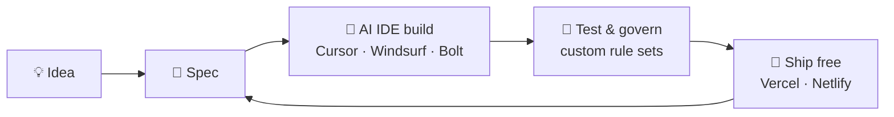

<!-- ============================ HERO ============================ -->

<picture>
  <source media="(prefers-color-scheme: dark)"  srcset="https://capsule-render.verc<!-- ============================ HERO ============================ -->

<picture>
  <source media="(prefers-color-scheme: dark)"  srcset="https://capsule-render.vercel.app/api?type=venom&color=0:0d1117,50:1f6feb,100:00f7ff&height=240&section=header&text=Likhith%20Kami&fontSize=64&fontColor=ffffff&animation=twinkling&fontAlignY=40&desc=AI%20%C2%B7%20Full-Stack%20%C2%B7%20Zero-Cost%20Builder&descSize=20&descAlignY=62">
  <source media="(prefers-color-scheme: light)" srcset="https://capsule-render.vercel.app/api?type=venom&color=0:ffffff,50:54aeff,100:0969da&height=240&section=header&text=Likhith%20Kami&fontSize=64&fontColor=0d1117&animation=twinkling&fontAlignY=40&desc=AI%20%C2%B7%20Full-Stack%20%C2%B7%20Zero-Cost%20Builder&descSize=20&descAlignY=62&descColor=0d1117">
  
</picture>

 

---

## 🧭 Quick Intro

> **I build useful AI products fast, using AI-assisted workflows, local models, and free-tier infrastructure so ideas ship without a budget.**

| | |
|:--|:--|
| 🎓 **Education** | B.Tech, AI & Data Science (final year) |
| 🏅 **Community** | Microsoft Learn Student Ambassador |
| 🧠 **Focus** | AI-powered web & desktop apps, local LLMs, prompt tooling |
| ⚙️ **Style** | Vibe coder: spec first, AI-assisted build, ship, iterate |
| 💸 **Principle** | Zero-cost stacks: free APIs, Vercel/Netlify, BYOK |
| 📫 **Open to** | Internships, collaborations, and AI/web projects |

---

## 🚀 Featured Projects

<table>
<tr>
<td width="50%" valign="top">

#### 🔍 PromptLens
**Prompt analyzer & optimizer**

Multi-dimensional prompt scoring, diff-based rewrites, BYOK with a free demo tier.

`Web App` `LLM APIs` `BYOK`

🟠 *In active development*

</td>
<td width="50%" valign="top">

#### 🐾 PixelPet
**Desktop widget platform**

Grew from a pet reminder app into a multi-widget overlay system with a premium tier.

`Tauri` `Rust` `Zustand`

🔵 *Spec complete*

</td>
</tr>
<tr>
<td width="50%" valign="top">

#### 🎙️ JARVIS
**Offline voice assistant**

JARVIS-style assistant running on a local LLM (LM Studio + Gemma). Private, no cloud.

`Python` `Local LLM` `Voice`

🔵 *Spec complete*

</td>
<td width="50%" valign="top">

#### 🚌 College Bus Tracker
**Real-time tracking, $0 infra**

Capstone app showing live bus positions on OpenStreetMap.

`Flutter` `Firebase RTDB` `OpenStreetMap`

🟢 *Capstone project*

</td>
</tr>
</table>

<b>📌 More from my GitHub</b>

 

---

## 🧪 How I Build

- **Local-first AI:** Claude Code wired to LM Studio, running Qwen2.5 Coder 7B on a 4GB GPU.
- **Governed AI coding:** a custom ruleset keeps AI IDEs consistent and safe.
- **Incremental over from-scratch:** build on proven pieces, ship in small steps.

---

## 🛠️ Tech Stack

 
 
 

---

## 📊 GitHub Snapshot

<picture>
  <source media="(prefers-color-scheme: dark)"  srcset="https://github-readme-stats.vercel.app/api?username=likhith3035&show_icons=true&theme=tokyonight&hide_border=true&count_private=true">
  <source media="(prefers-color-scheme: light)" srcset="https://github-readme-stats.vercel.app/api?username=likhith3035&show_icons=true&theme=default&hide_border=true&count_private=true">
  
</picture>
<picture>
  <source media="(prefers-color-scheme: dark)"  srcset="https://github-readme-stats.vercel.app/api/top-langs/?username=likhith3035&layout=compact&theme=tokyonight&hide_border=true">
  <source media="(prefers-color-scheme: light)" srcset="https://github-readme-stats.vercel.app/api/top-langs/?username=likhith3035&layout=compact&theme=default&hide_border=true">
  
</picture>

<picture>
  <source media="(prefers-color-scheme: dark)"  srcset="https://streak-stats.demolab.com?user=likhith3035&theme=tokyonight&hide_border=true">
  <source media="(prefers-color-scheme: light)" srcset="https://streak-stats.demolab.com?user=likhith3035&theme=default&hide_border=true">
  
</picture>

---

## 🤝 Let's Build Something

Have an AI or web idea, or need someone who ships? Reach out.

<picture>
  <source media="(prefers-color-scheme: dark)"  srcset="https://capsule-render.vercel.app/api?type=waving&color=0:00f7ff,50:1f6feb,100:0d1117&height=120&section=footer">
  <source media="(prefers-color-scheme: light)" srcset="https://capsule-render.vercel.app/api?type=waving&color=0:0969da,50:54aeff,100:ffffff&height=120&section=footer">
  
</picture>

el.app/api?type=venom&color=0:0d1117,50:1f6feb,100:00f7ff&height=240&section=header&text=Likhith%20Kami&fontSize=64&fontColor=ffffff&animation=twinkling&fontAlignY=40&desc=AI%20%C2%B7%20Full-Stack%20%C2%B7%20Zero-Cost%20Builder&descSize=20&descAlignY=62">
  <source media="(prefers-color-scheme: light)" srcset="https://capsule-render.vercel.app/api?type=venom&color=0:ffffff,50:54aeff,100:0969da&height=240&section=header&text=Likhith%20Kami&fontSize=64&fontColor=0d1117&animation=twinkling&fontAlignY=40&desc=AI%20%C2%B7%20Full-Stack%20%C2%B7%20Zero-Cost%20Builder&descSize=20&descAlignY=62&descColor=0d1117">
  
</picture>

 

---

## 🧭 Quick Intro

> **I build useful AI products fast, using AI-assisted workflows, local models, and free-tier infrastructure so ideas ship without a budget.**

| | |
|:--|:--|
| 🎓 **Education** | B.Tech, AI & Data Science (final year) |
| 🏅 **Community** | Microsoft Learn Student Ambassador |
| 🧠 **Focus** | AI-powered web & desktop apps, local LLMs, prompt tooling |
| ⚙️ **Style** | Vibe coder: spec first, AI-assisted build, ship, iterate |
| 💸 **Principle** | Zero-cost stacks: free APIs, Vercel/Netlify, BYOK |
| 📫 **Open to** | Internships, collaborations, and AI/web projects |

---

## 🚀 Featured Projects

<table>
<tr>
<td width="50%" valign="top">

#### 🔍 PromptLens
**Prompt analyzer & optimizer**

Multi-dimensional prompt scoring, diff-based rewrites, BYOK with a free demo tier.

`Web App` `LLM APIs` `BYOK`

🟠 *In active development*

</td>
<td width="50%" valign="top">

#### 🐾 PixelPet
**Desktop widget platform**

Grew from a pet reminder app into a multi-widget overlay system with a premium tier.

`Tauri` `Rust` `Zustand`

🔵 *Spec complete*

</td>
</tr>
<tr>
<td width="50%" valign="top">

#### 🎙️ JARVIS
**Offline voice assistant**

JARVIS-style assistant running on a local LLM (LM Studio + Gemma). Private, no cloud.

`Python` `Local LLM` `Voice`

🔵 *Spec complete*

</td>
<td width="50%" valign="top">

#### 🚌 College Bus Tracker
**Real-time tracking, $0 infra**

Capstone app showing live bus positions on OpenStreetMap.

`Flutter` `Firebase RTDB` `OpenStreetMap`

🟢 *Capstone project*

</td>
</tr>
</table>

<b>📌 More from my GitHub</b>

 

---

## 🧪 How I Build

- **Local-first AI:** Claude Code wired to LM Studio, running Qwen2.5 Coder 7B on a 4GB GPU.
- **Governed AI coding:** a custom ruleset keeps AI IDEs consistent and safe.
- **Incremental over from-scratch:** build on proven pieces, ship in small steps.

---

## 🛠️ Tech Stack

 
 
 

---

## 📊 GitHub Snapshot

<picture>
  <source media="(prefers-color-scheme: dark)"  srcset="https://github-readme-stats.vercel.app/api?username=likhith3035&show_icons=true&theme=tokyonight&hide_border=true&count_private=true">
  <source media="(prefers-color-scheme: light)" srcset="https://github-readme-stats.vercel.app/api?username=likhith3035&show_icons=true&theme=default&hide_border=true&count_private=true">
  
</picture>
<picture>
  <source media="(prefers-color-scheme: dark)"  srcset="https://github-readme-stats.vercel.app/api/top-langs/?username=likhith3035&layout=compact&theme=tokyonight&hide_border=true">
  <source media="(prefers-color-scheme: light)" srcset="https://github-readme-stats.vercel.app/api/top-langs/?username=likhith3035&layout=compact&theme=default&hide_border=true">
  
</picture>

<picture>
  <source media="(prefers-color-scheme: dark)"  srcset="https://streak-stats.demolab.com?user=likhith3035&theme=tokyonight&hide_border=true">
  <source media="(prefers-color-scheme: light)" srcset="https://streak-stats.demolab.com?user=likhith3035&theme=default&hide_border=true">
  
</picture>

---

## 🤝 Let's Build Something

Have an AI or web idea, or need someone who ships? Reach out.

<picture>
  <source media="(prefers-color-scheme: dark)"  srcset="https://capsule-render.vercel.app/api?type=waving&color=0:00f7ff,50:1f6feb,100:0d1117&height=120&section=footer">
  <source media="(prefers-color-scheme: light)" srcset="https://capsule-render.vercel.app/api?type=waving&color=0:0969da,50:54aeff,100:ffffff&height=120&section=footer">
  
</picture>

