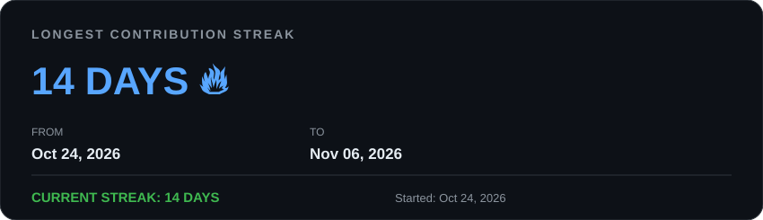
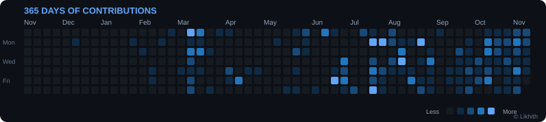

 <!-- ═════════════════════════════════════════════════════ -->
<!--                    PROFILE HEADER                     -->
<!-- ═══════════════════════════════════════════════════════ -->

 

  

  

---

**ENGINEER MINDS. BUILD PRODUCTS. EXPLORE POSSIBILITIES.**

*Turning ideas, experiments, and emerging technologies into working software.*

## 01 / ABOUT

I'm **Likhith Kami**, an Artificial Intelligence and Data Science undergraduate with a strong interest in software engineering, AI applications, and product development.

I enjoy working across the software development lifecycle — from exploring an idea and designing its architecture to building, testing, and deploying functional applications.

My work spans web applications, Android development, desktop software, automation, and AI-powered systems.

I believe the best way to understand technology is to build with it.

**Currently interested in:**
- AI-powered applications and intelligent systems.
- Full-stack and cross-platform development.
- On-device AI and local language models.
- Modern application architecture and product engineering.
- Developer tools, automation, and experimentation.

---

## 02 / PROJECTS

A selection of applications, experiments, and products I've worked on.

### Featured repositories

  

<a href="https://github.com/likhith3035?tab=repositories">Explore all repositories →</a>

### Other projects

| Project | Description |
|:--|:--|
| **AuraMusic** | An Android music application focused on offline listening, intelligent features, and a refined audio experience. |
| **StudentHub** | A campus collaboration platform for sharing resources and connecting students. |
| **Kiosk Vision** | An offline-first smart kiosk concept combining local AI, voice, gestures, and UPI QR generation. |
| **NBKRIST Department AI** | A retrieval-augmented AI assistant for accessing academic and departmental information. |
| **DigitalGuard** | An Android digital-wellbeing application exploring app control and activity-aware interactions. |
| **News 24/7** | A news platform featuring RSS integration, bookmarks, and a personalized browsing experience. |
| **Smart Recruitment Assistant** | An AI-assisted recruitment application exploring candidate evaluation and recruitment workflows. |

---

## 03 / TECHNOLOGY STACK

Technologies and tools I work with or actively explore.

**PROGRAMMING LANGUAGES**

  

  

**FRONTEND & APPLICATION DEVELOPMENT**

  

  

**DATABASES & CLOUD**

  

  

**DEVELOPER ENVIRONMENT**

  

---

<!-- ═══════════════════════════════════════════════════════ -->
<!--                  GITHUB STATISTICS                      -->
<!-- ═══════════════════════════════════════════════════════ -->

## 04 / GITHUB STATISTICS

<!-- GitHub Stats -->

<!-- Most Used Languages -->

  

<!-- Contribution Activity Graph -->

  

  

<!-- GitHub Profile Link -->

  

<!-- ═════════════════════════════════════════════════════ -->

## 05 / ACHIEVEMENTS

### 2nd Prize — IEEE-CIS Chatbot Buildathon

**TECHTATVA · 2K25**

Recognition for building a chatbot solution as part of a competitive technical event.

---

## 06 / CONNECT

### Let's build something meaningful.

I'm interested in connecting with developers, engineers, and innovators who enjoy turning challenging ideas into practical products.

Open to meaningful collaborations, internships, and interesting engineering opportunities.

 

  

<a href="https://devlikhith.vercel.app">devlikhith.vercel.app</a>

  

Curiosity drives the ideas. Engineering brings them to life.

